# The Animo walker in simulation

How the first Animo model learned to walk in MuJoCo before a single part was
printed. It started as a T-rex with a wagging tail and a nodding head; it
ended as a duckling that waddles on two rocking soles, driven by nothing but
two hip servos swinging back and forth. Open loop, no sensors.

Research log, 28–31 October 2026. The code is in [`sim/`](../../sim); every
plot here comes from one of its scripts (`*_plot.py`, run with FreeCAD's
Python, which has matplotlib).

## The setup

- **The cube:** the Animo cube with four MG90D servos; two of them drive the
  legs (hip joints on the side walls). Brain (ESP32 + battery) on top.
- **The model:** `sim/trex_sim.py` builds the robot from the CAD macro's
  meshes (`cad/animo_trex.py`), with assumed masses (cube ~185 g, brain
  60–75 g, legs ~10–20 g each).
- **The servo:** a position loop like the real one (P gain 3 N·m/rad,
  ±0.2 N·m), later with the MG90D's torque–speed line.
- **Robustness:** never trust one run. Every candidate is run in several
  scenarios — rhythm ±5 %, brain 60/75 g, slippery or grippy floor — and
  later from nudged starts (small roll and pitch pushes at t = 0).

## 1. Tail, head and slow steps (28–29 Oct)

The first gait used a tail to start the rocking and a head that poked
forward to tip the body onto the leading foot. It walked, but barely
(10–24 cm in 40 s) and was extremely sensitive: 5 % of rhythm or 20° of
phase turned it round. Slow quasi-static steps (a 40 g tail shifting the
weight, flat soles) were deterministic but crawled at ~0.4 cm/s.

The turning point was looking at [Mugatu](https://arxiv.org/abs/2308.08401)
(CMU 2023): one hip servo, rounded feet, and the passive rocking does the
work. **Passive dynamics is the right path; the problem was making the
rocking reliable, not the rocking itself.**

## 2. Rocking on rounded feet

Each foot became a cap of a sphere, cut at the body's middle. The contact
path on the sole tells how the foot rolls:

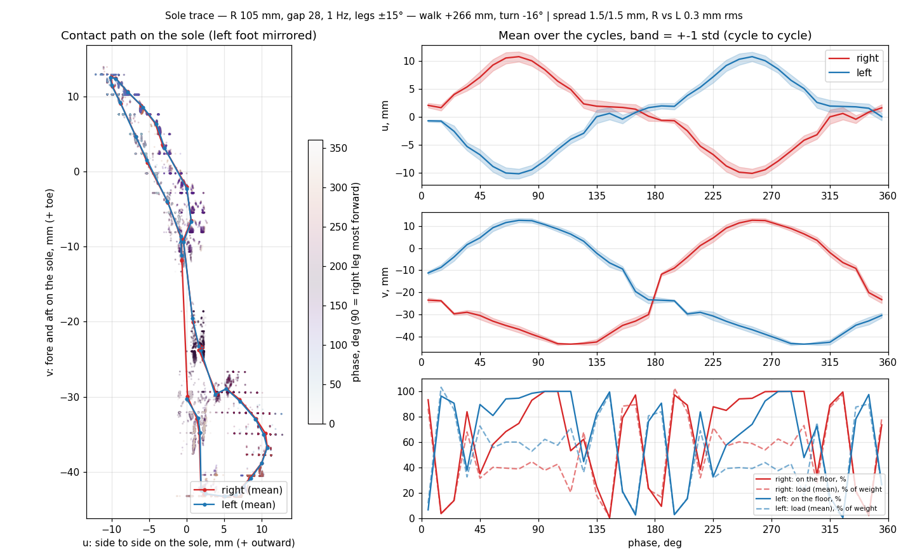

*First rounded feet at ~1 Hz: the contact runs diagonally from toe-inside
to heel-outside, very repeatable (1.5 mm cycle to cycle), but both feet sit
on the floor a third of the cycle.*

**The feet start alternating when the legs hit hard enough.** Sweeping leg
amplitude against rhythm, the jump from double support to alternation
happens at a peak leg acceleration of amplitude × (2πf)² ≈ 80 rad/s²,
whatever the amplitude — the sphere's radius barely matters, it only sets
how far the body rocks:

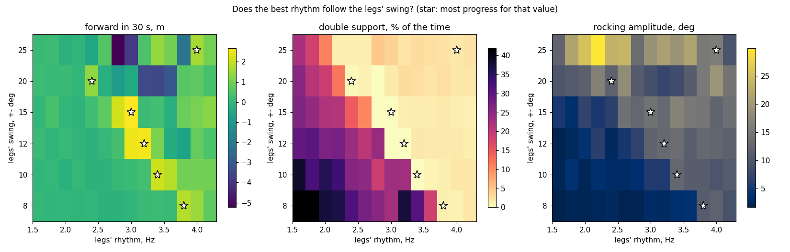

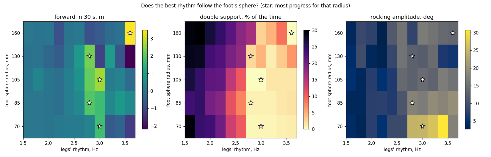

Above the threshold the soles trace a half moon each, and the two together
draw an ∞ — the hand-over happens at the inner edge:

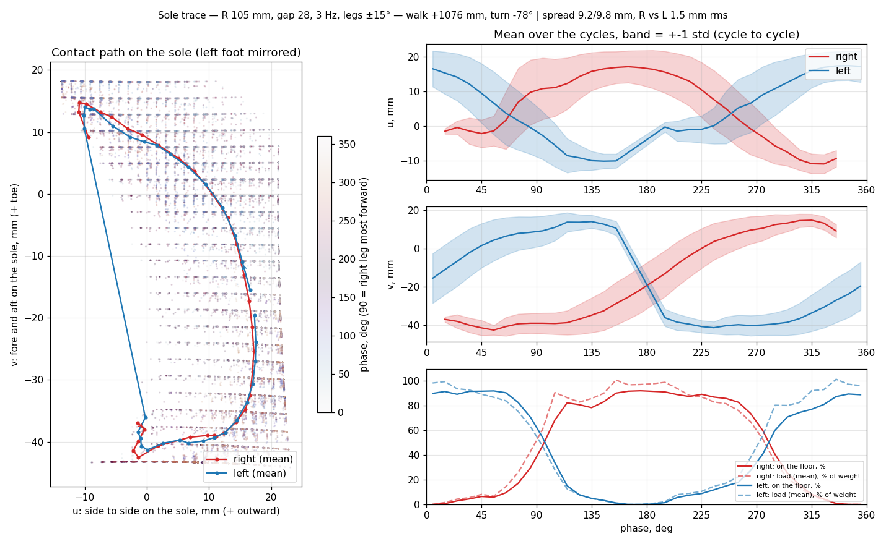

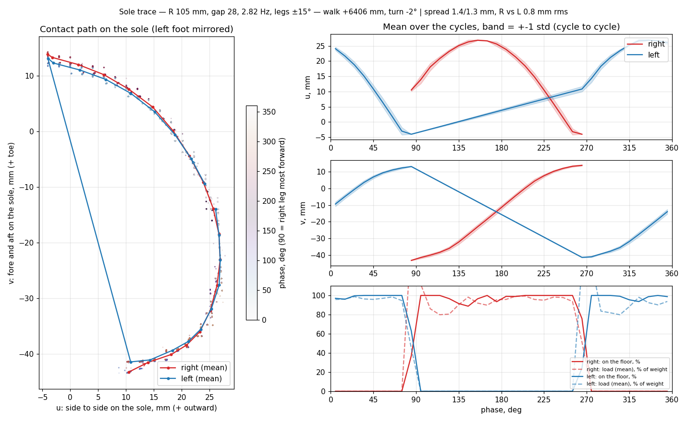

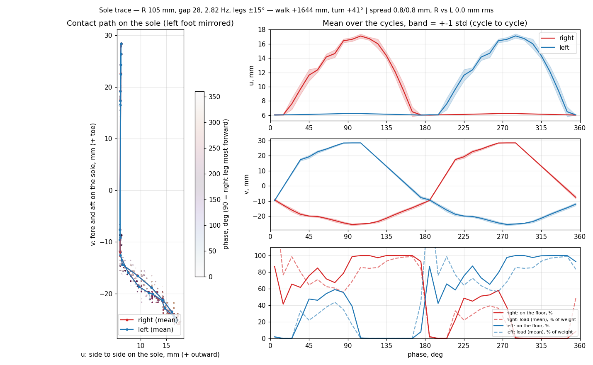

*Cutting the inner edge by 10 mm (just at the trace) is harmless; by 20 mm
the foot rolls along the edge instead, the rocking halves and alternation
is lost. The inner part of the sole is where the weight rolls from one foot
to the other.*

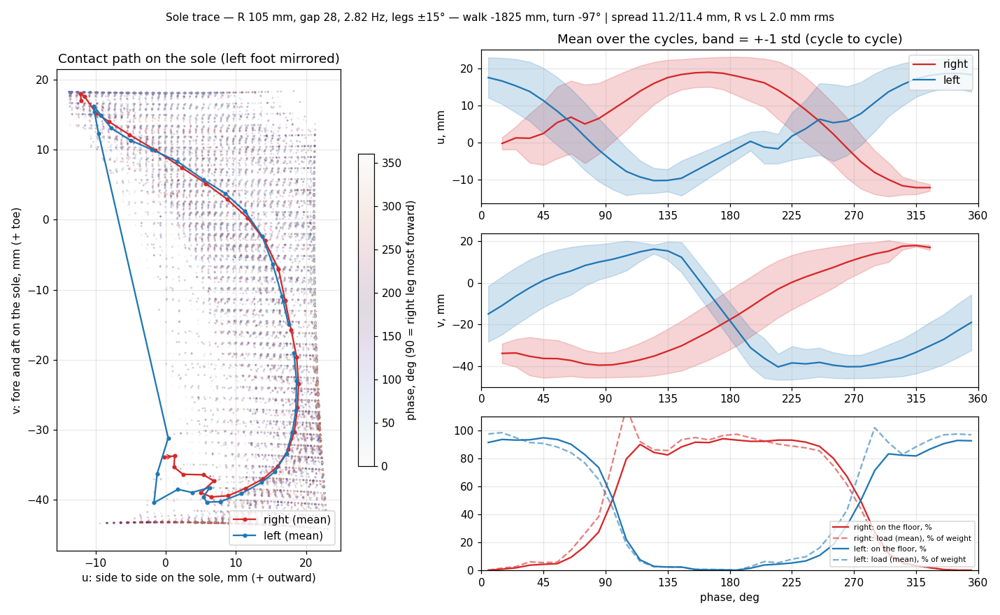
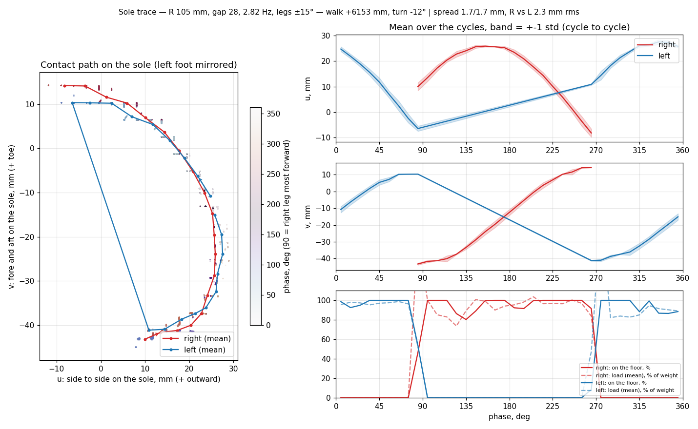
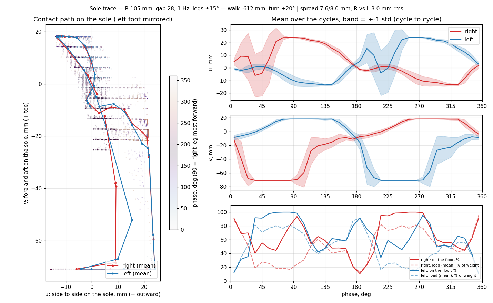

*Lesson learned the hard way: a coarser mesh on a bigger foot changed the
heading from −97° to −12°. With the facet size fixed (2 mm) all foot sizes
walk the same. The fast gait is that sensitive.*

## 3. The heading is chaotic

At 3.7 Hz the robot walked 4–8 m in 120 s — but four copies of the same
run, started with a 1e-6 rad/s yaw nudge, ended pointing anywhere. A random
walk in heading, not a bias: nothing to trim away in open loop.

## 4. Longer legs, the mirror branch, the brain down

Longer legs (hip 92 mm instead of 52) with the feet scaled to match bring
the threshold down like a pendulum (2.8 → 2.0 Hz). But the gait became
**bistable**: the same settings walk forward or backward, mirror images,
and a 0.5 mm change picks which.

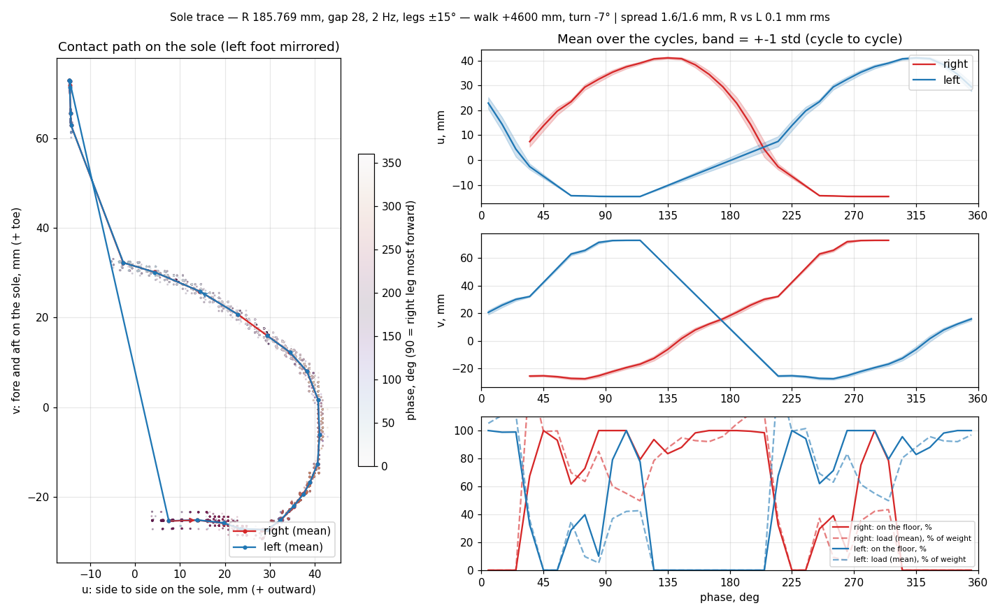
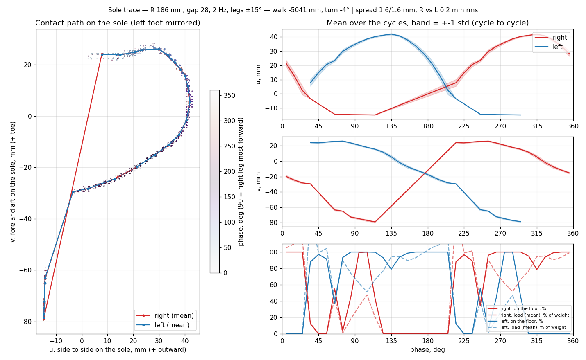

*The two branches are fore-aft mirrors: forward uses the toe, backward the
heel.*

A short heel (40 mm) leaves the backward gait nothing to stand on. Turning
the cube upside down (brain under the hip) lowers the centre of mass and
the walk goes straight — no more chaos:

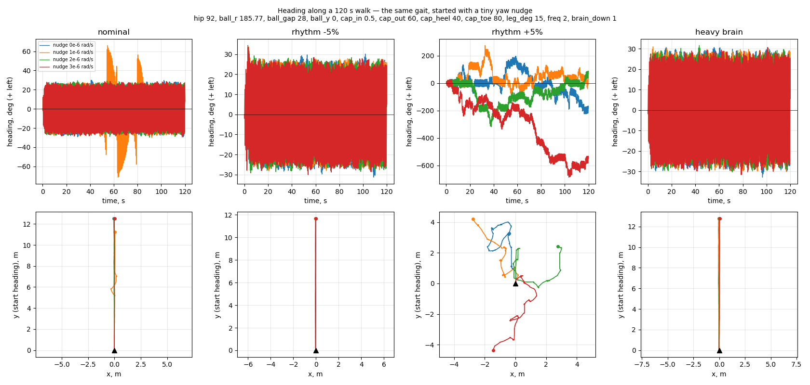

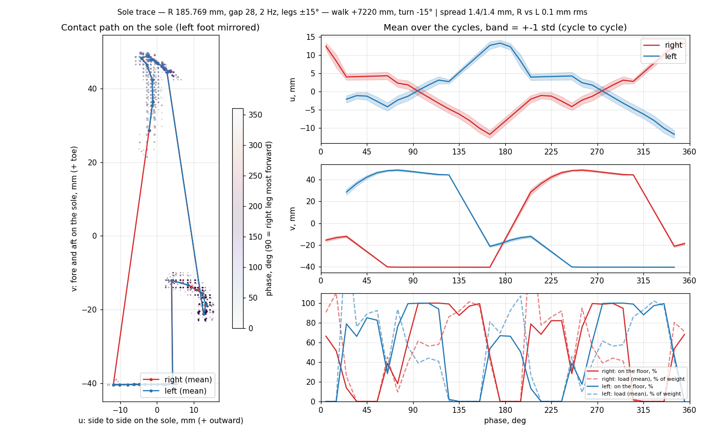

*With the centre of mass low the foot no longer rolls: it steps heel–toe,
and the sharp edge of the cut heel acts as a stop.*

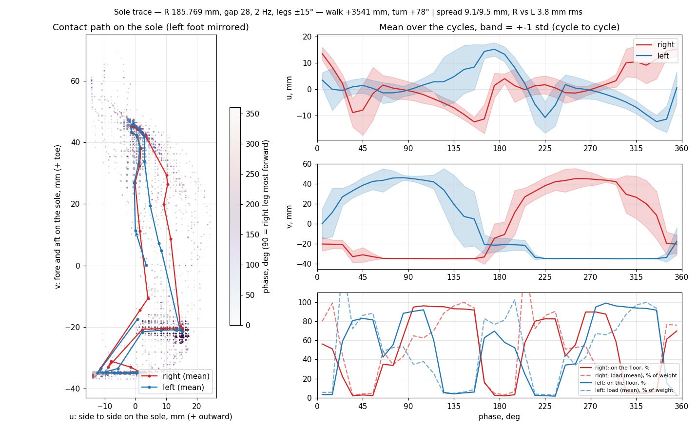

*Rounding that edge (as a printed part would be) loses the repeatability:
9 mm spread instead of 1.4. The sharp edge is part of the mechanism.*

Light foot weights (10 g instead of 40) and the feet closer (14 mm) removed
a yaw wobble the weights were causing, and the half moon came back, wider:

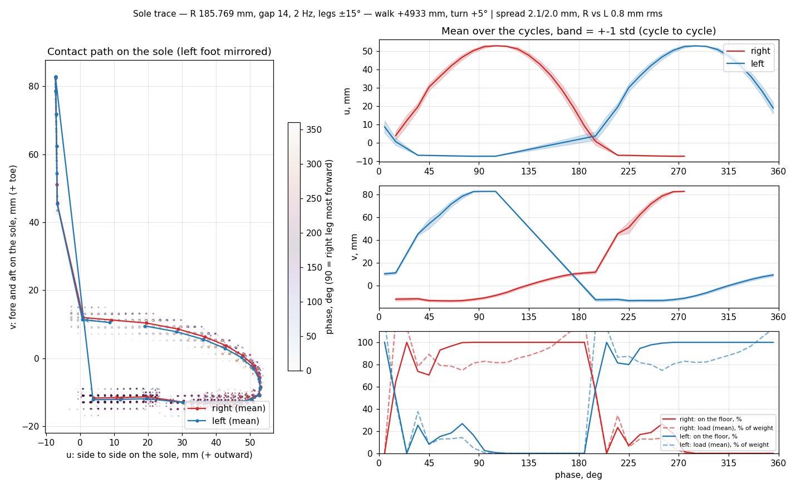
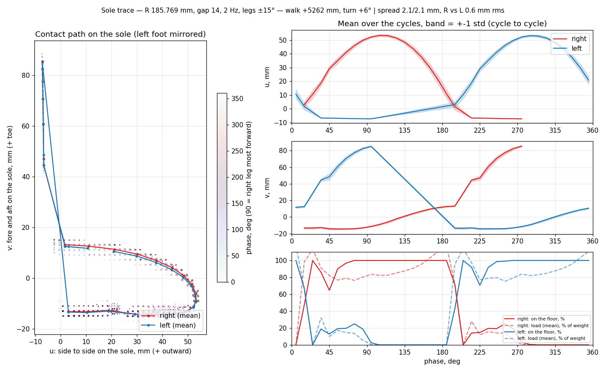

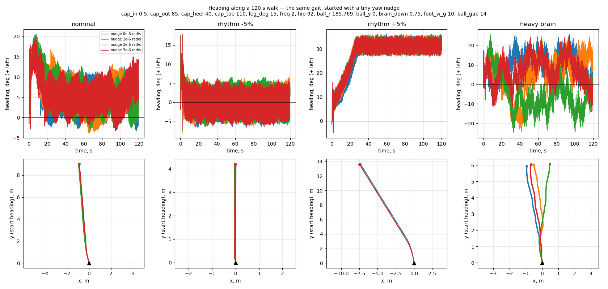

*All four nudged copies agree: no chaos, 9–15 m in 120 s.*

## 5. Two planes, two ideal models (30 Oct)

To understand rather than sweep, each plane was modelled alone.

**Frontal plane** (`sim/frontal.py`): a rigid body rocking on two arcs cut at
the middle. It is not two valleys but one V-shaped well, like a stool; at
the middle the support jumps from foot to foot with a knock. **Smaller
swings rock faster**, and the theory

  f₀ = √(g·b / (k² + h²)) / 2π, with b = R − h

matches the model within 5–10 %. A lower centre of mass rocks *faster*
(the roly-poly effect), a smaller frontal radius or closer feet slower.

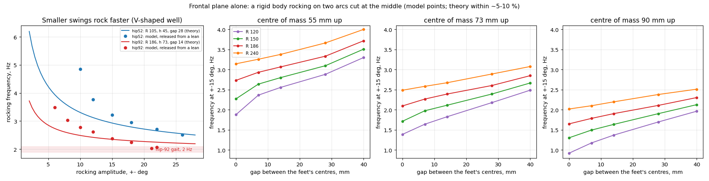

**Sagittal plane** (`sim/sagittal.py`): body plus two servo legs, with the
frontal rocking replaced by imposed alternate support at phase φ. The step
is exactly **4 · A · H · cos(φ − 180°)** per cycle, whatever the sole's
radius: the leg is the wheel's radius. The phase decides the direction (the
mirror branch is φ ≈ 0°); the sole radius only sets stability, best at
about twice the hip height.

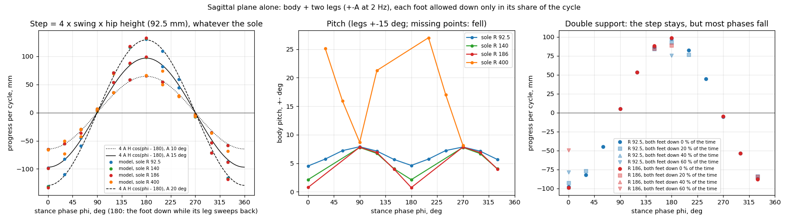

**Coupled:** the real phase is set by the rhythm against the rocking's own
frequency, like a forced oscillator. Just below resonance φ approaches 180°
and the step is good; just past it the gait jumps to the mirror branch.
Hence the narrow rhythm window.

## 6. Lower rhythm: the doubly curved sole

The frontal model wants a small radius (slower rocking), the sagittal one a
large radius (stability). So the sole got two radii: **frontal 120–130 mm,
fore-aft 186 mm**, feet 7 mm apart. That brought the rhythm down to
1.2–1.4 Hz with 85–95 % of the ideal step.

**The servo is not critical.** With the MG90D's datasheet line (4.8 V:
0.206 N·m stalled, 10.5 rad/s free) nothing changes: peak torque comes in
stance with the leg slow, peak speed in swing with little load. The best
gait uses 54 % (p95) of the line.

## 7. The duckling (30–31 Oct)

Keeping the cube as it is (brain on top), the feet were tuned for it. The
waddle that came out — side to side, wide flat feet, short steps — is a
duck's, so the first model became a duckling.

| | |
|---|---|
| Hip height | 92 mm |
| Sole radius | 130 mm side to side, 186 mm fore and aft |
| Feet gap | 7 mm |
| Sole extent | 60 mm outward, 80 toe, 40 heel |
| Outline | full width from y −10 to 25 mm, rounding in to 50 at the heel and 15 at the toe |
| Foot weights | 10 g |
| Legs | ±15° at 1.2 Hz, right leg starting backward (phase 180°) |
| Result | ~10 cm/s, turn ≤8° in 30 s, rhythm window ±5 % |

The rounded outline follows the measured footprint over 54 nudged starts:
the foot reaches 58 mm outward only between y 0 and 20, and never touches
the outer toe corner.

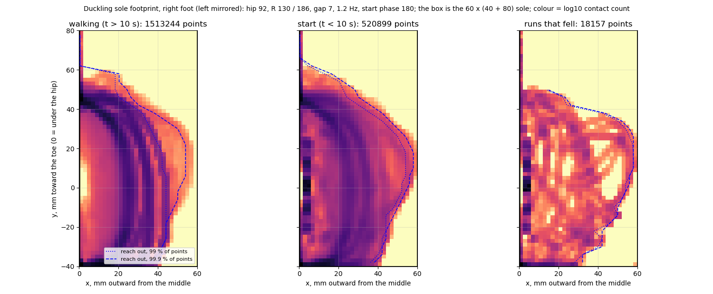

**Open issue:** about 1 start in 5 goes wrong (backward branch or a fall);
starting with the right leg backward is the best start found. Without a
sensor that cannot reach zero — in the real cube, if it starts badly, you
pick it up and start again.

## Reproduce

The viewer, with the duckling as above:

```bash
& sim/ver.ps1 gait=0 tail=0 tail_deg=0 tail_only_s=0 fade_s=2 lean=0 head=0 foot_w_g=10 hip=92 ball_r=130 ball_rs=186 ball_gap=7 ball_y=0 cap_in=0.5 cap_out=60 cap_heel=40 cap_toe=80 cap_wide_from=-10 cap_wide_to=25 cap_heel_x=50 cap_toe_x=15 brain_down=0 leg_deg=15 freq=1.2 phase=180 foot_mu=1.2 foot_spin=5
```

The run data (CSV, ~200 MB) stays out of the repo; each study script
regenerates its own in `sim/out/`.
